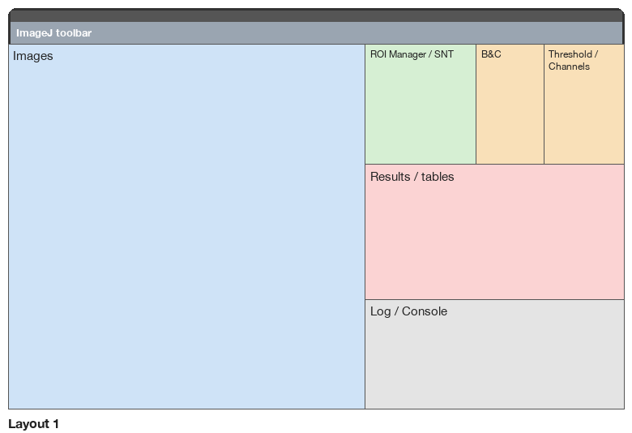
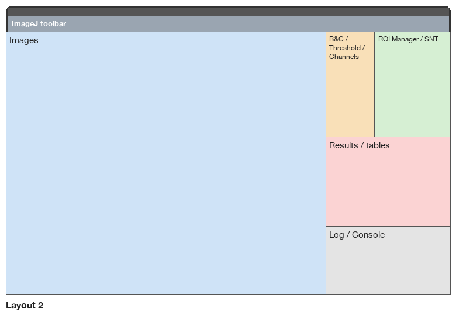
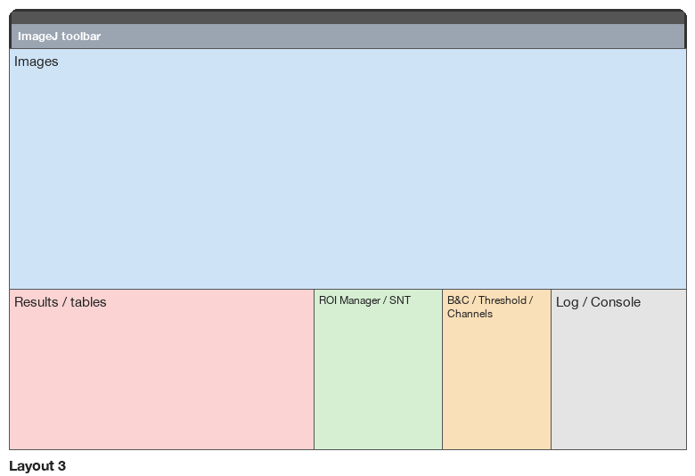
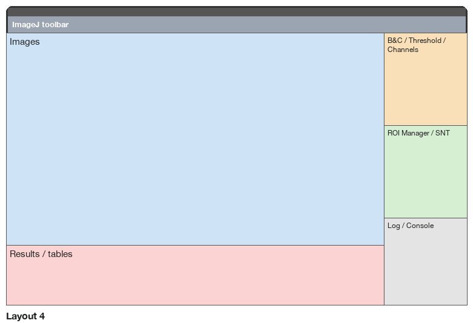
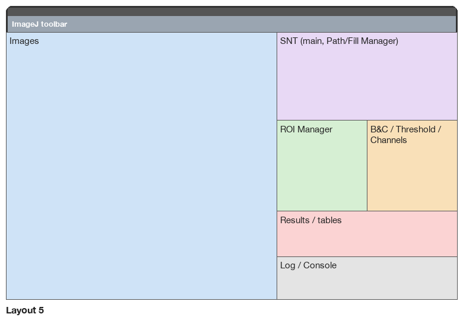
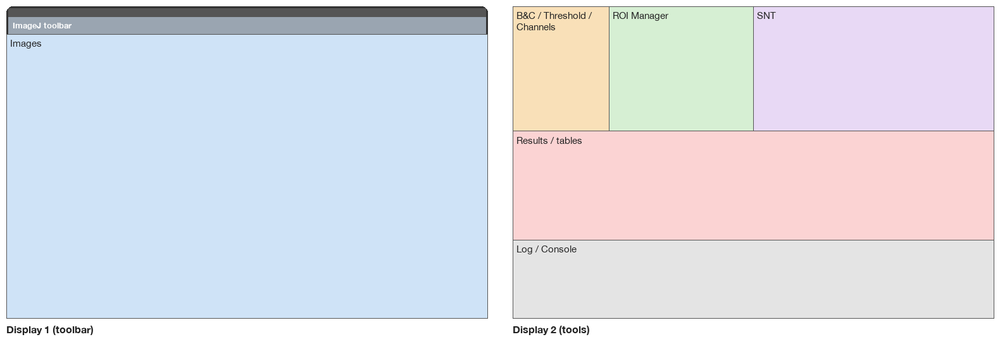

<h1 align="center">Fiji Window Layouts</h1>

<p align="center"><b>Numbered window layouts, snap zones and exact saving of any arrangement, so that Fiji's windows are always where you want them.</b></p>

<p align="center">
  
  
  <a href="LICENSE"></a>
  
  
</p>

<p align="center">
  <a href="#why">Why</a> ·
  <a href="#highlights">Highlights</a> ·
  <a href="#quick-start">Quick start</a> ·
  <a href="#installation">Installation</a> ·
  <a href="#the-built-in-layouts">Built-in layouts</a> ·
  <a href="#menu-reference-plugins--window-layouts">Menu reference</a>
</p>



## Why

Fiji opens every window wherever it likes, so a working session starts with dragging and resizing: images on top of each other, the ROI Manager behind an image, the Results table off screen. **Window Layouts** places Fiji's windows for you as they open, and puts everything back in order with one keystroke.

## Highlights

| Feature | What you get |
|---|---|
| **Ten layouts, one key each** | **Cmd+Option+0** to **9** on macOS, **Ctrl+Alt+0** to **9** on Windows and Linux, re-arranges every Fiji window at once |
| **Automatic placement** | images and tool windows go to their place in the active layout as soon as they open; images are tiled and zoomed to fill their area |
| **Six designs to start from** | balanced, image first, analysis bench, side-by-side comparison, neuron tracing, two displays |
| **Save exactly what you see** | arrange the windows by hand and save the arrangement: every position, size and image zoom comes back |
| **Snap zones** | send the active window to a half, a quarter, a third or two thirds of the screen, or to another display |
| **Only Fiji's windows** | other applications are never moved |
| **Scriptable** | every command works in macros, for example `run("Layout 3");` |

## Quick start

1. Install the two files (see [Installation](#installation)) and restart Fiji.
2. Open some images and tool windows (ROI Manager, B&C, Results): they go to their places in layout 1.
3. Press **Cmd+Option+2**, **3**, ... (**Ctrl+Alt+2**, **3**, ... on Windows and Linux) to try the other layouts.
4. Click an image and press **Cmd+Option+←** to snap it to the left half; **Cmd+Option+Delete** puts it back (on Windows and Linux: **Ctrl+Alt+←** and **Ctrl+Alt+Backspace**).
5. Arrange the windows the way you like and choose **Plugins ▸ Window Layouts ▸ Save Current Arrangement...** to keep it in any slot.
6. **Plugins ▸ Window Layouts ▸ Window Layouts Shortcuts** shows every shortcut inside Fiji.

### On Windows and Linux

The shortcuts in this guide are written for macOS. On Windows and Linux the plugin uses **Ctrl+Alt** instead of **Cmd+Option**, by itself:

| macOS | Windows and Linux |
|---|---|
| **Cmd+Option** + key | **Ctrl+Alt** + key |
| **Cmd+Option+Delete** (back to where it was) | **Ctrl+Alt+Backspace** (Ctrl+Alt+Delete belongs to the system) |

- **AltGr keeps typing.** Windows and Linux report the AltGr key as Ctrl+Alt, and on many keyboards AltGr with a digit or a letter types a character (@, #, {, [). While a text field has the focus (a dialog, the macro editor, the Log), Ctrl+Alt+key is therefore left to the field. Click an image or a tool window to use the shortcuts.
- **If your system already uses Ctrl+Alt.** Some graphics drivers on Windows rotate the screen with Ctrl+Alt+arrows; Linux desktops use Ctrl+Alt with the arrows (workspaces), T (terminal) or L (lock). Such keys never reach Fiji. Choose another pair, for example **Alt+Shift**, in *Plugins ▸ Window Layouts ▸ Window Layouts Preferences...*; *Window Layouts Shortcuts* always lists the keys in use.

## Three plugins that work together

Each plugin works on its own; installed together, they share the screen and each other's commands.

All three are written in Java 8 for any system Fiji runs on, and their shortcuts follow your system: **Cmd** on macOS, **Ctrl** on Windows and Linux. So far they have been tested on macOS only; reports from Windows and Linux are welcome in each repository's *Issues*.

| Plugin | What it gives you |
|---|---|
| [**Side Toolbar**](https://github.com/AIHector/Fiji-Side-Toolbar) | Fiji's toolbar as a vertical bar you can reshape freely, plus a shelf for open tools, live image previews and macro buttons |
| **Window Layouts** (this one) | Ten numbered window layouts, snap zones and exact saving of any arrangement, with a keyboard shortcut for each |
| [**Undo History**](https://github.com/AIHector/Fiji-Undo-History) | Multi-level undo and redo with a history panel: pixels, selections, overlays, display, calibration, ROI Manager and Results |

- **Window Layouts** keeps every layout clear of Side Toolbar's bars and status strip, and re-arranges the windows when a bar changes size or place.
- **Side Toolbar**'s image previews offer Window Layouts' placements (halves, thirds, quarters, other display, layouts 0 to 9) and Undo History's steps in their right-click menu.
- **Side Toolbar** adds an *Undo History* button to the bar when Undo History is installed, and **Window Layouts** places the Undo History window like any other tool window.

## The layouts in detail

- **Ten layout slots, 0 to 9, all editable.** Slots 1 to 6 start with six built-in designs; slots 0, 7, 8 and 9 start empty. You can save over any slot at any time, and **Reset Layout...** brings a built-in design back.
- **Automatic placement.** Images and tool windows go to their place in the active layout as soon as they open. Images are tiled and zoomed to fill their area.
- **A shortcut for each layout.** Press **Cmd+Option+0** to **9** at any moment to rearrange everything.
- **Snap zones, like Magnet, but only for Fiji.** Send the active Fiji window to a half, quarter or third of the screen, or to another display.
- **Compose your own layout.** Arrange the windows by hand and save the arrangement, or type the zones as numbers.

Everything is in the menu **Plugins ▸ Window Layouts**, and every setting is saved at once (it survives a crash or a forced quit).

## Installation

The plugin consists of two files in your Fiji folder (the one that contains `plugins/` and `macros/`: `Fiji.app` on Windows and Linux; on macOS, `Fiji.app` or the folder that contains it):

- the plugin: `plugins/Fiji_Window_Layouts.jar`
- the startup hook, which starts it when Fiji opens (`run("Start Window Layouts");`): `macros/AutoRun/Window_Layouts_Startup.ijm`

**From a release.** Download `Window_Layouts-<version>.zip` from the [Releases](../../releases) page, unzip it, copy the two files to those places, and restart Fiji.

Without the AutoRun macro the menu commands still work, but the shortcuts and the automatic placement only start after you use one of the commands (or **Plugins ▸ Window Layouts ▸ Start Window Layouts**).

**From the source** (macOS; the script uses the Java inside Fiji), close Fiji and run:

```bash
git clone https://github.com/AIHector/Fiji-Window-Layouts.git
cd Fiji-Window-Layouts
./test.sh     # 549 headless unit tests
./build.sh    # compiles with Fiji's own Java and installs both files
```

`build.sh` takes the Fiji folder as an optional argument (`./build.sh /path/to/Fiji`).

To uninstall, delete the two files above.

## How windows are grouped

A layout places *kinds* of windows. A window whose kind has no zone in the active layout, or that is not in this table, stays where it opens, with one exception: if it opens under the Side Toolbar's bars or its status strip (Fiji's Console, for example), it moves just beside them, keeping its size when it fits.

| Kind (name used in zones) | Windows |
|---|---|
| `images` | every image window: single images, stacks, hyperstacks, composites, plots |
| `b&c` | Brightness/Contrast (B&C), Window/Level (W&L) |
| `roi` | ROI Manager |
| `threshold` | Threshold, Threshold Color |
| `channels` | Channels Tool |
| `results` | Results, Summary and every other ImageJ table or text window |
| `log` | Log |
| `console` | Fiji's Console (uses the `log` zone when a layout gives it none) |
| `snt` | SNT main window ("SNT v5.0.21"), Path Manager, Fill Manager, Neuroanatomy Shortcuts |
| (toolbar) | the ImageJ toolbar is put at the top of display 1 and stretched across its width (Preferences can turn the stretching off) |

How each kind is placed:

- **Images** are tiled in a grid inside their zone, as square as possible (2 images side by side, 3 or 4 in 2×2, 5 or 6 in 3×2, ...). By default (**Image zoom: fill**) each image window takes its whole cell and the image is zoomed to cover it, so there is no empty space; when the image's shape differs from the cell, its edges are cropped (pan with the hand tool or by holding the space bar; ImageJ's small navigator box shows which part is in view). Preferences offer **fit** (the whole image, as large as fits; the window then wraps the image) and **steps** (the whole image at ImageJ's standard zooms). **Plots** are redrawn at the size of their cell instead of being zoomed.
- **No space between windows.** Zones that touch share their edge to the pixel, the work area starts right under the toolbar, and every built-in layout tiles the whole screen.
- **Results, Log, Console and ROI Manager** are resized to fill their zone. ROI Manager is never made shorter than 220 px, so its buttons stay usable.
- **Fixed-size tools** (B&C, Threshold, Channels, SNT) keep their own size and are moved to the top-left corner of their zone.
- **Shared slots.** Some kinds share a slot, for example B&C, Threshold and Channels, since you rarely use all of them at once. If several are open together they **cascade** 24 px down-right, so every title bar stays visible.
- **No hidden title bars.** A fixed tool can be taller than its zone (B&C is 303 px). The window below it (Results, Log or ROI Manager) then gives up height from its top, so it starts just below the tool. If that would make it shorter than its minimum, it stays where it is.

## The built-in layouts

### The built-in designs

The diagrams show your laptop screen (1512 × 982 points). On any screen the zones are percentages of the area below the ImageJ toolbar (the **work area**), so they scale. The tables give the zones in that unit, exactly as **Edit Layout...** shows them. You can copy a table into a custom layout and change it.

### Layout 1: balanced

Images on the left 58%. On the right: ROI Manager, B&C and Threshold in a row, then Results, then Log.


| kind | zone `x,y,w,h` (% of work area) |
|---|---|
| images | `0,0,58,100` |
| b&c | `76,0,11,33` |
| roi, snt | `58,0,18,33` |
| threshold, channels | `87,0,13,33` |
| results | `58,33,42,37` |
| log | `58,70,42,30` |

### Layout 2: image first

The largest image area (72%). One narrow column on the right: B&C next to the ROI Manager, then Results, then Log.



| kind | zone `x,y,w,h` (% of work area) |
|---|---|
| images | `0,0,72,100` |
| b&c, threshold, channels | `72,0,11,40` |
| roi, snt | `83,0,17,40` |
| results | `72,40,28,34` |
| log | `72,74,28,26` |

### Layout 3: analysis bench

Images across the top 60%. A bench of tools along the bottom: Results, ROI Manager, B&C, Log.



| kind | zone `x,y,w,h` (% of work area) |
|---|---|
| images | `0,0,100,60` |
| b&c, threshold, channels | `64,60,16,40` |
| roi, snt | `45,60,19,40` |
| results | `0,60,45,40` |
| log | `80,60,20,40` |

### Layout 4: side-by-side compare

A wide image area for comparing images next to each other, a full-width Results strip below, tools in a column on the right.



| kind | zone `x,y,w,h` (% of work area) |
|---|---|
| images | `0,0,82,78` |
| b&c, threshold, channels | `82,0,18,34` |
| roi, snt | `82,34,18,34` |
| results | `0,78,82,22` |
| log | `82,68,18,32` |

### Layout 5: neuron tracing

Images on the left 60%. The SNT windows get the top right, with ROI Manager and B&C below, then Results and Log.



| kind | zone `x,y,w,h` (% of work area) |
|---|---|
| images | `0,0,60,100` |
| b&c, threshold, channels | `80,33,20,34` |
| roi | `60,33,20,34` |
| results | `60,67,40,17` |
| log | `60,84,40,16` |
| snt | `60,0,40,33` |

### Layout 6: two displays

Images fill display 1 (the one with the toolbar); all tools go to display 2. **With only one display, layout 6 behaves like layout 2** and the status bar says so.



| kind | zone `x,y,w,h` (% of work area) |
|---|---|
| images | `0,0,100,100` |
| b&c, threshold, channels | `0,0,20,40@2` |
| roi | `20,0,30,40@2` |
| results | `0,40,100,35@2` |
| log | `0,75,100,25@2` |
| snt | `50,0,50,40@2` |

## Your own layouts: every slot, 0 to 9

### Save Current Arrangement

1. Arrange the windows by hand (or with the snap keys).
2. **Plugins ▸ Window Layouts ▸ Save Current Arrangement...**
3. Choose the slot (0 to 9) and type a name. The slot becomes the active layout. Saving into slots 1 to 6 replaces the built-in design until you reset it.

The plugin records **exactly what is on screen**:

- **Every image window**: its place, its size, its zoom and the part of the image in view.
- **Every other window, by its title**: B&C, ROI Manager, Results, Log, Console, Undo History, and any plugin's window.
- For each kind of window (images, B&C, ROI Manager...), also the area it covers, so windows of that kind that open later have a place too.

Press **Cmd+Option+** the slot number to bring the arrangement back:

- Each window that was saved goes back to its exact place and size (to the pixel), on its display.
- An image that was open when you saved goes back to its own window, with its zoom. Other images take the remaining saved image windows, top-left first, zoomed to fit them as the *Image zoom* preference says. Images beyond the saved windows cascade from the last one.
- Windows saved by title are placed again when they open later, while that layout is active.

Positions are stored relative to the work area (the screen minus the Side Toolbar and the ImageJ strip), so a layout still fits if the bar changes width.

**To set up layouts 1 to 4 for 1, 2, 3 and 4 images**: open your tools and one image, arrange everything, save into slot 1; open a second image, arrange, save into slot 2; and so on. *Re-arrange now* (or a built-in layout) tiles the images first if you want a starting point: 2 images side by side, 3 images in three columns, 4 images in a 2 × 2 grid.

### Edit Layout

**Plugins ▸ Window Layouts ▸ Edit Layout...** opens two dialogs:

1. **Edit slot**: which slot to write (0 to 9; default: the active one). **Start from**: which layout fills the second dialog (default: the active one). To start from a built-in layout and change it, choose it here.
2. One line per kind of window, plus a name.

Zone syntax:

| You type | Meaning |
|---|---|
| `0,0,60,100` | x, y, width, height in **percent of the work area** (the screen below the ImageJ toolbar on display 1; the whole usable screen on other displays) |
| `12.5,0,30,40` | decimals use a **dot** (a comma separates the four numbers) |
| `0,50,100,50@2` | `@2`, `@3`... puts the zone on another display (see *Multiple displays*) |
| *(blank)* | this kind of window is not managed by the layout |

### Reset Layout

**Plugins ▸ Window Layouts ▸ Reset Layout...** removes what you saved in a slot: slots 1 to 6 return to their original design, slots 0, 7, 8 and 9 become empty.

The dialog refuses a zone that does not have four numbers, has a width or height of 0, or extends past 100% (for example `60,0,50,10`). It names the field and saves nothing. Typing `12,5` (a decimal comma) produces five numbers and is refused.

Empty slots show `(empty)` in the slot lists. Pressing the shortcut of an empty slot only shows *"slot N is empty"* in the status bar.

## Keyboard shortcuts

All shortcuts use the **modifier**: **Cmd+Option** by default on macOS, **Ctrl+Alt** on Windows and Linux (see [On Windows and Linux](#on-windows-and-linux)). It can be changed in Preferences. Magnet uses Ctrl+Option and Ctrl+Option+Cmd, so the two never collide. The shortcuts work while any Fiji window is in front (image, toolbar, Results, ...), and they never reach other applications.

| Modifier + | Action |
|---|---|
| **0** ... **9** | apply layout 0 ... 9 (numeric keypad digits work too) |
| **.** or **=** | next layout (skips empty slots; 9 wraps to 0) |
| **,** or **-** | previous layout |
| **A** | turn automatic placement off / on (turning it on rearranges at once) |
| **←** / **→** | left / right half |
| **↑** / **↓** | top / bottom half |
| **U** / **I** / **J** / **K** | top-left / top-right / bottom-left / bottom-right quarter |
| **S** (or **D**) / **F** / **G** | left / center / right third |
| **E** / **T** | left / right two-thirds |
| **C** | center (keeps the size) |
| **Return** | maximize (the whole work area) |
| **Delete** | restore the size and place from before the last snap |
| **N** or **]** | move the window to the next display |
| **P** or **[** | move the window to the previous display |

Notes for this Mac:

- **Cmd+Option+D is taken by macOS** by default (show/hide the Dock), so it never reaches Fiji. Use **S** for the left third, or turn the Dock shortcut off in System Settings ▸ Keyboard ▸ Keyboard Shortcuts ▸ Launchpad & Dock.
- **Spanish keyboard.** Java reads keys by their *position* on a US keyboard. The keys labelled `.`, `,` and the digits work as printed, and so does the key labelled `-` (right of `.`). The `'` key right of `0` also works as *previous layout*. Keys that need Shift or Option on a Spanish keyboard (`=`, `[`, `]`) are matched by position: `=` is the `¡` key, `[` is the `` ` `` key, `]` is the `+` key. The letter alternatives (**.**, **,**, **N**, **P**) are easier to remember.
- ImageJ's own single-key shortcuts are not affected: a key the plugin uses is consumed before ImageJ sees it. A key the plugin does *not* use, pressed with Cmd+Option, still reaches ImageJ. For example Cmd+Option+`/` used to open *Reslice*, which is why `/` is now also *previous layout*.

## Snap zones

Snapping acts on the **active Fiji window** (the one you clicked last). It never acts on the ImageJ toolbar. Zones are computed on the display the window is on, using the work area, so a snapped window never covers the toolbar.

- **Images** follow the *Image zoom* preference (default: fill the zone completely).
- **Resizable windows** (Results, Log, ROI Manager, Console) take the exact zone.
- **Fixed-size windows** (B&C, Threshold...) are moved to the zone's corner and keep their size.
- **Restore** (Delete) returns the window to where it was before the last snap or display move.
- **Next / previous display** keeps the window's relative position, clamped so it stays on the target screen, and keeps an image's zoom. Displays are visited in the order 1 → 2 → 3 → 1.

The same zones are in the menu **Plugins ▸ Window Layouts ▸ Snap Zones** (halves, maximize, restore) and in **Snap Active Window...**, a dialog with all 18 zones.

## Automatic placement

When on (the default), new windows are placed according to the active layout as they open. When an image closes, the remaining images are re-tiled. A window you move by hand stays where you put it until the next window opens or closes (images re-tile) or you apply a layout.

- **Toggle Automatic Placement** (menu) or **Cmd+Option+A** turns it off and on. Turning it on applies the active layout immediately.
- **Re-arrange now** applies the active layout again, for example after moving windows by hand.
- If you prefer to arrange images by hand and only use the shortcuts, turn automatic placement off. Layout and snap shortcuts keep working.

## Exact save: verification (22 October 2026)

In a separate copy of Fiji: three images (400×300, 256×256, 600×200) at chosen places and zooms, with B&C, Log and Undo History, saved into slot 7; after layout 2 rearranged everything, *Layout 7* put every window back to the pixel (position and size) and gave each image its own zoom again (150%, 160%, 399%). Two new images then took the first free saved windows, top-left first. 536 unit tests pass, 17 of them for exact layouts.

## With the Side Toolbar

When the Side Toolbar plugin shows Fiji's toolbar as a vertical bar, every layout fills the screen *beside* the bar, and below the ImageJ status strip (or above it, when the strip is at the bottom of the screen). The Side Toolbar places the ImageJ window itself, so Window Layouts no longer stretches it across the top. When the bar changes side or width, the windows are re-arranged.

Verified on 21 October 2026: layouts 1 to 5 with two images, ROI Manager, B&C and Log put every window beside the bar and below the strip; an image opened in the installed Fiji went to (40, 89), next to the 40 px bar and under the 55 px strip, and moved to (74, 89) when the bar grew to two columns. 519 unit tests (now 536), 4 of them for the bar's band.

## Multiple displays

Displays are numbered for `@N` and for display moves:

- **Display 1** is the display that holds the ImageJ toolbar (applying a layout puts the toolbar at its top-left).
- **Displays 2, 3, ...** are the others, from left to right (then top to bottom).

On this Mac that gives: **1** = the laptop screen, **2** = the portrait monitor on the left, **3** = the monitor above. A zone on a display that is not connected falls back to display 1 (this rule is in the code but was not tried live).

## Preferences

**Plugins ▸ Window Layouts ▸ Window Layouts Preferences...**

| Option | Default | Effect |
|---|---|---|
| Shortcut modifier | `cmd+alt` (Cmd+Option) | also `ctrl+alt`, `ctrl+shift`, `alt+shift`. Ctrl+Option would clash with Magnet. |
| Place windows automatically as they open | on | same as Toggle Automatic Placement |
| Image zoom | fill | `fill`: no empty space, edges may be cropped; `fit`: whole image, as large as fits; `steps`: whole image at standard zooms |
| Stretch the ImageJ toolbar across the screen | on | the toolbar takes the full width of display 1 |
| Write a key log to `~/fijilayouts-debug.log` | off | records every Cmd/Option/Ctrl key the plugin sees, for troubleshooting shortcuts. Leave it off otherwise. |

## Menu reference (Plugins ▸ Window Layouts)

| Command | What it does |
|---|---|
| Layout 0 ... Layout 9 | apply that slot (status message if it is empty) |
| Re-arrange now | apply the active layout again |
| Snap Active Window... | choose one of 18 snap zones for the active window |
| Save Current Arrangement... | store the current arrangement in any slot, 0 to 9 |
| Edit Layout... | edit any slot numerically |
| Reset Layout... | slots 1-6 back to the original design, other slots emptied |
| Toggle Automatic Placement | on / off |
| Window Layouts Preferences... | modifier, automatic placement, key log |
| Window Layouts Shortcuts | the shortcut list, the active layout and the placement state |
| Snap Zones ▸ ... | left / right / top / bottom half, maximize, restore |
| Start Window Layouts | starts the plugin (the AutoRun macro calls this) |

All commands can be used in macros, for example `run("Layout 3");` or `run("Snap Active Window...", "zone=right-third");`.

## Where settings are stored

In Fiji's preferences file, `~/Library/Preferences/IJ_Prefs.txt`, written immediately after every change:

| Key | Meaning |
|---|---|
| `.fijilayouts.active` | active layout (0-9) |
| `.fijilayouts.auto` | automatic placement on/off |
| `.fijilayouts.mod` | shortcut modifier |
| `.fijilayouts.debug` | key log on/off |
| `.fijilayouts.custom.0` ... `.9` | zones you saved in that slot (empty = built-in design or empty slot), e.g. `images=0,0,60,100;log=0,50,100,50@2` |
| `.fijilayouts.name.0` ... `.9` | names of the saved layouts |

To reset everything, quit Fiji and delete the lines starting with `.fijilayouts.`.

## Troubleshooting

| Problem | Fix |
|---|---|
| Shortcuts do nothing | Check that a Fiji window is in front. Check that `Window_Layouts_Startup.ijm` is in `Fiji/macros/AutoRun`, or run **Start Window Layouts**. Check the modifier in Preferences. |
| One shortcut does nothing | macOS or another app may own it (Cmd+Option+D = Dock). Turn on the key log in Preferences, press the key, and look at `~/fijilayouts-debug.log`: if the key is not listed, it never reached Fiji. |
| A window is not placed | Its kind is not in *How windows are grouped*, or the active layout leaves that kind blank, or automatic placement is off. |
| Tools overlap | Several fixed-size tools sharing one slot cascade over each other by design. On a small screen, close tools you do not need, or use layout 6 with a second display. |
| Part of an image is hidden | *Image zoom: fill* crops the edges so the window has no empty space. Pan with the hand tool, or choose *fit* in Preferences to always see the whole image. |
| Fiji says "Plugin configuration error" at startup | A command name in `plugins.config` clashes with another plugin. Rebuild after renaming the entry. |

## Verification report (14-15 October 2026)

Everything below was tested on this Mac (Fiji 2.18.0 / ImageJ 1.54p, Java 21, macOS, three displays, Spanish keyboard). Positions were read from Fiji itself and cross-checked with macOS accessibility (System Events): both always agreed. Expected positions were recomputed independently from the zone percentages.

**Passed**

- 515 headless unit tests (`./test.sh`): zone parsing and validation, serialization round trips, built-in layouts (inside the screen, no overlapping zones), zone and snap arithmetic against hand-computed pixels, image grid, zoom choice, custom layout storage, next/previous skipping empty slots, key mapping, modifier matching, window classification, display order, layout 6 fallback rule.
- Fiji starts with no configuration error. The toolbar and the Log are placed at startup; the Console is placed when it opens.
- **Layouts 1-5** with 2 images + B&C + ROI Manager + Results + Log + Console: every window at its computed position, by automatic placement and by **real key presses** (Cmd+Option+1-5, physical key codes). 42/42 checks per layout, with no overlaps.
- **More windows**: 3 images (with a 20-slice stack), 4 images (with a 4000 × 3000 image, zoomed to 1/12), then a composite image, Channels, Threshold and a plot. Every window was at its expected position in all layouts; the plot was redrawn to its cell.
- **Layout 6** on the real second display (portrait monitor): images on display 1, all tools on display 2. 42/42.
- **All 18 snap zones** on an image, on Results (resizable) and on B&C (fixed size): 17/17 each, restore included. Halves, quarters, thirds, two-thirds, center and maximize were also tested with real key presses on an image.
- **Display moves** N, P, ], [ across all three displays, for an image, B&C and Results.
- **Next / previous layout** with real key presses (`.` `,` `-` `=`), including wrap-around past empty slots.
- **Re-tiling when an image closes**: 3 images → close one → the other two re-tiled and enlarged.
- **Toggle automatic placement**: menu and the toggle key (tested as Cmd+Option+0, then again as Cmd+Option+A after the change to ten slots). With it off, new windows are not moved; turning it on rearranges at once.
- **Empty slots**: status message, active layout unchanged.
- **Gapless layouts and your default** (15 October): slot 1 saved from your arrangement. After a restart, with an image, B&C, ROI Manager, Results, Log and Console open, every window was at its computed place and they tiled the screen with no gaps: toolbar 0-1512 × 34-120; image 0-892 × 120-934 (fill zoom 345%); ROI Manager 892-1358 and B&C 1358-1512 × 120-423; Log 423-701; Console 701-934. The Console, which Fiji re-shows rather than re-opens, is now placed too. 515 unit tests, including a check that every built-in layout tiles its work area exactly.
- **Ten editable slots** (15 October): Cmd+Option+0 on an empty slot 0 shows a status message. An arrangement saved into slot 0 came back with Cmd+Option+0 after switching to layout 2: every tool window returned exactly, and the images were re-tiled inside the saved image area. Built-in slot 3 was edited (images in the top half) and applied with Cmd+Option+3. Reset Layout then restored the original layout 3 (34/34 checks) and emptied slot 0. Next/previous layout cycle through 0-9. 505 unit tests.
- **Save Current Arrangement** → layout 1 → Cmd+Option+7: every window returned to its saved place (8/8).
- **Edit Layout**: both dialogs shown and confirmed through the real GUI (slot saved). Field values, blank fields, `@2`, and the error for an invalid zone (nothing saved) were tested through the same dialog in macro mode. The layout produced matched the typed percentages, including a Log zone on display 2.
- **Preferences**: dialog shown and confirmed. Switching the modifier (with Ctrl+Option chosen, Ctrl+Option+3 applied layout 3) and switching the key log off (no more lines written) were tested in macro mode.
- **Wrong modifiers ignored**: Ctrl+Option, Ctrl+Option+Cmd (Magnet's), Cmd+Option+Shift, Cmd alone, Option alone.
- **Shortcuts help** and **Snap Active Window** dialogs shown; the snap dialog moved the active window to the chosen zone.
- **SNT** (after the FlatLaf fix of 15 October): the main window "SNT v5.0.21" and Path Manager were recognised as SNT windows. With layout 5, a real Cmd+Option+5 put the main window at the top-left of the SNT zone (922, 126) and cascaded Path Manager 24 px down-right (946, 150). Both are taller than the zone, so they cover the ROI Manager / B&C area below; SNT windows keep their own size.
- **Persistence**: active layout, automatic placement, modifier and custom slots survive a File ▸ Quit and relaunch, and are on disk immediately after each change (before quitting).

**Not verified**

- **SNT Fill Manager and Neuroanatomy Shortcuts** windows (recognised by title, not opened live).
- **Your own fingers on the keyboard.** Key presses were sent as real macOS key events (System Events key codes) and as Java key events. Please try a few shortcuts yourself; if one fails, turn on the key log.
- **Layout 6 on a single display.** The fallback to layout 2 is unit-tested, but could not be tried live with three monitors connected.
- **The 3D Viewer, BigDataViewer and other special viewers.** They are treated as images but only moved, never zoomed; not tried.
- **Ctrl+Shift and Alt+Shift modifiers** were tested only in unit tests (Ctrl+Option was also tested live).
- **The Dock on the side or a different toolbar size.** The maths uses the real screen insets and toolbar height, but only this configuration was tried.

## Known limitations

- On the 14-inch screen there is not enough room for every tool at once. B&C, Threshold and Channels cascade in one slot and can overlap a neighbouring window (Threshold is 303 px wide).
- A window moved to another display and back can end a few pixels from where it started (it is clamped to stay on screen). Delete (restore) returns it exactly.
- Snapping or rearranging re-zooms images (fill, fit or steps); it does not keep a zoom you set by hand.
- Fixed-size tools (B&C, Threshold, Channels) cannot be stretched: if their zone is larger than they are, some desktop shows around them.
- Custom layouts store one rectangle per kind of window, not per individual window.

## Files

| Path | Content |
|---|---|
| `src/fijilayouts/WindowLayouts_.java` | the plugin |
| `src/plugins.config` | its menu entries |
| `test/fijilayouts/LayoutTests.java` | headless unit tests (`./test.sh`) |
| `test/harness/fijilayouts/TestHarness.java` | development-only live-test helper (not installed) |
| `docs/make_diagrams.py` | draws the layout diagrams in this guide |
| `build.sh`, `test.sh` | build/install, unit tests |
| `README.md`, `README.pdf` | this guide |
| `LICENSE` | MIT License |

## License

MIT License, © 2026 Ettore Colombo. See [LICENSE](LICENSE).
